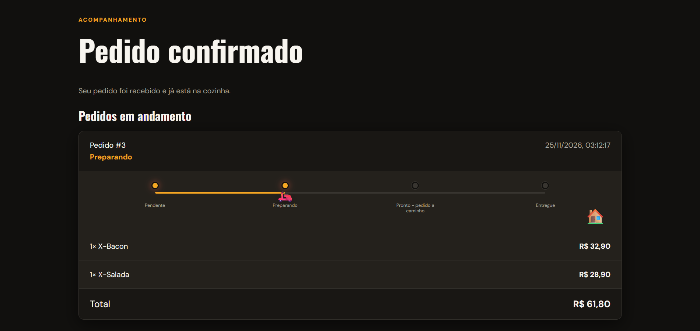

# Marcus's Burgers
[](https://opensource.org/licenses/MIT)

Aplicação full-stack para uma hamburgueria, desenvolvida com **React + Vite** no frontend e **Java + Spring Boot** no backend.

O projeto inclui catálogo por categorias, carrinho persistido, autenticação JWT, gerenciamento de endereços com consulta ViaCEP, checkout, controle de estoque e painel administrativo.

## 📸 Screenshots

### Checkout


### Pedidos do Cliente



### Painel Administrativo


## ✨Funcionalidades

- Catálogo de produtos agrupado por categoria.
- Imagens individuais dos produtos através de URLs.
- Carrinho com quantidade, remoção, limpeza e persistência no navegador.
- Cadastro e login com autenticação JWT.
- Validação de senha com mínimo de 8 e máximo de 72 caracteres.
- Cadastro e seleção de endereços do usuário.
- Busca automática de endereço por CEP integrada à API ViaCEP no backend.
- Limite de quantidade no carrinho conforme o estoque disponível.
- Controle de estoque com bloqueio pessimista, evitando que pedidos simultâneos vendam o mesmo último item.
- Teste automatizado de concorrência executado contra um PostgreSQL real (Testcontainers) para validar o controle de estoque.
- Atualização do catálogo e estoque após a finalização de pedidos.
- Perfil do usuário com nome e e-mail no cabeçalho.
- Criação e acompanhamento de pedidos.
- Painel administrativo para acompanhar e alterar status dos pedidos.
- Cadastro, edição e exclusão de categorias pelo administrador.
- Cadastro, edição e exclusão de produtos pelo administrador.
- Controle de acesso para usuários `CLIENT` e administradores `ADMIN`.
- Administrador pode consultar o cardápio e acessar o checkout, mas não possui carrinho nem pode confirmar pedidos.
- Navbar personalizada conforme o perfil do usuário.
- Validação de dados com Bean Validation.
- Documentação interativa da API com Swagger UI / OpenAPI.
- Execução do banco, backend e frontend com Docker Compose.
- Testes automatizados e integração contínua com GitHub Actions.
- Layout responsivo para computadores e dispositivos móveis.

## 🛠️ Tecnologias Usadas

### Backend

- Java 25
- Spring Boot 4.1.2
- Spring Web MVC
- Spring Data JPA
- Hibernate
- Spring Security
- OAuth2 Resource Server / JWT
- Springdoc OpenAPI / Swagger UI
- ViaCEP API com `RestClient`
- Bean Validation
- PostgreSQL
- H2 para execução local e Docker (perfil `test`)
- Maven
- Lombok
- JUnit 6.0.3
- Testcontainers 2.x (PostgreSQL nos testes de integração)

### Frontend

- React 19
- JavaScript ES6+
- Vite 8
- React Router DOM
- ESLint
- npm

### Infraestrutura

- Docker
- Docker Compose

### CI

- GitHub Actions
- GitHub Flow

## 📋 Pré-requisitos

Escolha uma das formas de execução:

| Forma de execução | Necessário |
|---|---|
| [Docker](#opção-1-docker-compose-recomendado) | Docker Desktop com Docker Compose e Git |
| [Local — perfil `test`](#opção-2-execução-local-com-perfil-test) | Java 25, Node.js 22 ou superior e Git |
| [Local — perfil `dev`](#opção-3-execução-local-com-postgresql-perfil-dev) | Java 25, Node.js 22 ou superior, PostgreSQL e Git |

> Para **executar os testes automatizados do backend** (`mvnw test` / `mvnw verify`), é necessário ter o **Docker em execução**, pois o teste de concorrência sobe um container PostgreSQL via Testcontainers. Veja a seção [Testes](#-testes).

Os comandos deste README assumem **Windows com PowerShell**.

No Linux/macOS, use `./mvnw` no lugar de `.\mvnw.cmd`.

## 🚀 Como Rodar na Minha Máquina

### Endereços da aplicação

| Serviço | Endereço |
|---|---|
| Loja (frontend) | http://localhost:5173 |
| API do backend | http://localhost:8080 |
| Swagger UI | http://localhost:8080/swagger-ui/index.html |
| OpenAPI JSON | http://localhost:8080/v3/api-docs |
| Console do H2 | http://localhost:8080/h2-console |
| PostgreSQL (Docker) | `localhost:5433` |
| PostgreSQL (instalado localmente) | `localhost:5432` |

### Opção 1: Docker Compose (recomendado)

Na raiz do projeto, copie o arquivo de exemplo:

```powershell
Copy-Item .env.example .env
```

Inicie a aplicação:

```powershell
docker compose up --build
```

Ou execute em segundo plano:

```powershell
docker compose up -d --build
```

Acesse:

http://localhost:5173

O perfil do backend é definido pela variável `SPRING_PROFILES_ACTIVE` no arquivo `.env`. Por padrão, o valor é `test`, que utiliza H2 em arquivo.

O banco H2 é persistido no volume Docker `h2_data`, portanto os dados permanecem disponíveis após reiniciar o container.

Não é necessário configurar PostgreSQL nem alterar manualmente a URL JDBC para executar a aplicação nesse perfil.

#### Comandos úteis

```powershell
# Executar em segundo plano
docker compose up -d --build

# Acompanhar os logs do backend
docker compose logs -f backend

# Verificar os containers
docker compose ps

# Parar os containers, mantendo os dados
docker compose down

# Parar e apagar os volumes e dados persistidos
docker compose down -v
```

> Atenção: `docker compose down -v` remove os volumes persistentes, incluindo os dados do H2 e do PostgreSQL. Utilize somente quando realmente desejar apagar esses dados.

### Opção 2: Execução local com perfil `test`

O perfil `test` utiliza H2 em arquivo e não exige instalação do PostgreSQL.

Abra dois terminais no VS Code.

#### Backend

No primeiro terminal:

```powershell
cd backend
.\mvnw.cmd spring-boot:run
```

Também é possível utilizar o Maven instalado:

```bash
mvn spring-boot:run
```

O backend iniciará em:

http://localhost:8080

O perfil `test` utiliza:

```text
jdbc:h2:~/test
```

#### Frontend

No segundo terminal:

```powershell
cd frontend
npm install
npm run dev
```

O frontend iniciará em:

http://localhost:5173

### Opção 3: Execução local com PostgreSQL (perfil `dev`)

Com o PostgreSQL instalado e em execução, configure o arquivo `.env` na raiz do projeto.

Exemplo:

```env
DB_HOST=localhost
DB_PORT=5432
DB_NAME=hamburgueria
DB_USERNAME=seu_usuario
DB_PASSWORD=sua_senha
JWT_SECRET=sua_chave_base64
SPRING_PROFILES_ACTIVE=dev
```

> Na execução local, use `DB_HOST=localhost`. O valor `db` é o nome do serviço PostgreSQL dentro da rede do Docker Compose.

Com `SPRING_PROFILES_ACTIVE=dev` no `.env`, basta executar:

```powershell
cd backend
.\mvnw.cmd spring-boot:run
```

Ou, para forçar o perfil `dev` pela linha de comando:

```powershell
.\mvnw.cmd spring-boot:run "-Dspring-boot.run.profiles=dev"
```

O frontend é iniciado da mesma forma descrita na opção anterior.

O perfil `dev` utiliza PostgreSQL e as variáveis de ambiente configuradas no `.env`.

### Utilizar PostgreSQL no Docker

Para utilizar PostgreSQL em vez de H2 no Docker, altere o perfil no arquivo `.env`:

```env
SPRING_PROFILES_ACTIVE=dev
```

Depois recrie o backend:

```powershell
docker compose up -d --build backend
```

O serviço PostgreSQL é acessado pelo backend através do host `db`, que corresponde ao nome do serviço no Docker Compose.

Não é necessário alterar o `docker-compose.yml` nem a URL JDBC. O perfil selecionado no `.env` define automaticamente o banco utilizado.

| Perfil no Docker | Banco | Persistência | Dados de demonstração |
|---|---|---|---|
| `test` (padrão) | H2 | Volume `h2_data` | Carregados pelo `data.sql` |
| `dev` | PostgreSQL | Volume `postgres_data` | Não carregados automaticamente |

## 📂 Estrutura do projeto

```text
ProjetoHamburgueria/
├── .github/
│   └── workflows/
│       └── ci.yml
├── backend/
│   ├── src/
│   │   ├── main/
│   │   │   ├── java/
│   │   │   └── resources/
│   │   └── test/
│   │       └── java/
│   ├── .dockerignore
│   ├── Dockerfile
│   └── pom.xml
├── frontend/
│   ├── src/
│   │   ├── components/
│   │   ├── hooks/
│   │   ├── pages/
│   │   ├── services/
│   │   ├── styles/
│   │   └── utils/
│   ├── .dockerignore
│   ├── Dockerfile
│   ├── package.json
│   └── vite.config.js
├── docs/
├── .env.example
├── docker-compose.yml
└── README.md
```

## Variáveis de ambiente

As variáveis de ambiente ficam em um único arquivo `.env`, localizado na raiz do projeto.

Clone o projeto e crie seu arquivo `.env` a partir do exemplo:

```powershell
Copy-Item .env.example .env
```

Depois, preencha os valores. Exemplo para uso com Docker Compose:

```env
# PostgreSQL
DB_HOST=db
DB_PORT=5432
DB_NAME=hamburgueria
DB_USERNAME=admin_user
DB_PASSWORD=change_me

# JWT
JWT_SECRET=your_base64_secret_here

# test = H2 | dev = PostgreSQL
SPRING_PROFILES_ACTIVE=test
```

### ⚙️ Variáveis disponíveis

| Variável | Descrição | Padrão |
|---|---|---|
| `DB_HOST` | Host do PostgreSQL (`db` no Docker, `localhost` na execução local) | `localhost` |
| `DB_PORT` | Porta do PostgreSQL | `5432` |
| `DB_NAME` | Nome do banco | `hamburgueria` |
| `DB_USERNAME` | Usuário do banco | Obrigatória no perfil `dev` |
| `DB_PASSWORD` | Senha do banco | Obrigatória no perfil `dev` |
| `JWT_SECRET` | Chave Base64 para assinatura e validação dos tokens JWT | Obrigatória no perfil `dev` |
| `SPRING_PROFILES_ACTIVE` | Perfil ativo do backend: `test` (H2) ou `dev` (PostgreSQL) | `test` |

A chave JWT deve possuir pelo menos 32 bytes após a decodificação Base64, conforme a configuração HS256 utilizada pelo projeto.

### Como o `.env` é utilizado

**Docker Compose**

O Docker Compose lê o `.env` localizado na raiz do projeto e repassa as variáveis ao container do backend.

O perfil do backend é escolhido por `SPRING_PROFILES_ACTIVE` no `.env`. Se a variável não existir, o Compose usa `test` como valor padrão. Para trocar de perfil, altere o valor no `.env` e recrie o backend:

```powershell
docker compose up -d --build backend
```

Dentro da rede Docker, o backend utiliza o nome do serviço PostgreSQL como host:

```text
db
```

O Compose sempre define `DB_HOST` como `db` para o backend, portanto o valor de `DB_HOST` no `.env` só importa na execução local.

**Execução local**

O `application.properties` importa o arquivo `.env` por meio de:

```properties
spring.config.import=optional:file:.env[.properties]
```

Execute o backend a partir da raiz do projeto ou da pasta `backend`, conforme a configuração do projeto.

O perfil também pode ser escolhido pelo `.env` na execução local: defina `SPRING_PROFILES_ACTIVE=dev` (PostgreSQL) ou `SPRING_PROFILES_ACTIVE=test` (H2). Se preferir, é possível sobrescrever pela linha de comando com `-Dspring-boot.run.profiles=dev`.

Como o import é opcional, a ausência do `.env` não gera erro quando o perfil `test` ou o CI não precisam das variáveis de PostgreSQL.

### Gerar uma chave JWT

No PowerShell:

```powershell
$bytes = New-Object byte[] 32
$rng = [System.Security.Cryptography.RandomNumberGenerator]::Create()
$rng.GetBytes($bytes)
[Convert]::ToBase64String($bytes)
```

No Linux/macOS:

```bash
openssl rand -base64 32
```

O token JWT expira em 3600 segundos (1 hora), conforme a configuração `security.jwt.expiration`.

> ⚠️ Nunca commite o arquivo `.env`. Ele está no `.gitignore`; apenas o `.env.example`, com valores fictícios, deve ser versionado. Utilize uma chave JWT exclusiva para cada ambiente.

## 🗄️ Perfis e banco de dados

O projeto possui configurações para diferentes ambientes:

| Perfil | Banco | Uso |
|---|---|---|
| `test` (padrão) | H2 em arquivo | Execução local e Docker |
| `dev` | PostgreSQL | Desenvolvimento com banco relacional real |

O perfil ativo é definido em `application.properties` e pode ser sobrescrito.

**Maven:**

```powershell
.\mvnw.cmd spring-boot:run "-Dspring-boot.run.profiles=dev"
```

**Docker:**

Altere `SPRING_PROFILES_ACTIVE` no arquivo `.env` e recrie o container com `docker compose up -d --build backend`.

Os testes automatizados também ativam o perfil `test` (para reaproveitar as configurações de JWT e demais propriedades), mas **sobrescrevem o datasource** com um container PostgreSQL temporário criado pelo Testcontainers. Assim, não há alteração no banco de desenvolvimento nem no arquivo H2 local.

### H2 Console

Com o backend em execução no perfil `test`, acesse:

http://localhost:8080/h2-console

Utilize as seguintes configurações:

| Campo | Valor |
|---|---|
| Driver Class | `org.h2.Driver` |
| JDBC URL | `jdbc:h2:~/test` |
| User Name | `sa` |
| Password | Deixe vazio |

No Docker, o banco H2 é persistido no volume `h2_data`.

Na execução local, o banco é armazenado em arquivo no diretório de trabalho do usuário que executa a aplicação.

> Mantenha o H2 Console habilitado apenas em ambientes de desenvolvimento ou testes. Não habilite esse recurso em produção.

## 🌐 Configuração da API no frontend

Por padrão, o frontend utiliza:

```text
http://localhost:8080
```

Para utilizar outra URL, crie um arquivo `.env` dentro da pasta `frontend`:

```env
VITE_API_URL=http://localhost:8080
```

Depois, reinicie o servidor Vite.

> No Docker, a URL da API utilizada pelo frontend deve continuar sendo `http://localhost:8080`, e não `http://backend:8080`. As requisições são realizadas pelo navegador, que roda na máquina do usuário e não acessa diretamente os nomes dos serviços da rede Docker.

## 📖 Documentação da API — Swagger

O projeto utiliza Springdoc OpenAPI para gerar a documentação da API e disponibilizar uma interface interativa para visualizar e testar os endpoints.

Com o backend em execução, acesse:

| Recurso | URL |
|---|---|
| Swagger UI | http://localhost:8080/swagger-ui/index.html |
| OpenAPI JSON | http://localhost:8080/v3/api-docs |

A documentação permite:

- Visualizar os endpoints disponíveis.
- Consultar métodos HTTP, parâmetros e respostas.
- Visualizar os modelos de requisição e resposta (DTOs).
- Testar requisições diretamente pela interface Swagger.

Os endpoints de documentação são públicos. Os endpoints protegidos continuam exigindo autenticação JWT.

## 🔌 Principais endpoints

| Método | Endpoint | Descrição | Autenticação |
|---|---|---|---|
| `POST` | `/auth/login` | Autentica e retorna JWT | Não |
| `GET` | `/products` | Lista produtos | Não |
| `GET` | `/products/{id}` | Busca um produto | Não |
| `POST` | `/products` | Cadastra produto | ADMIN |
| `PUT` | `/products/{id}` | Edita produto | ADMIN |
| `DELETE` | `/products/{id}` | Exclui produto | ADMIN |
| `GET` | `/categories` | Lista categorias | Não |
| `POST` | `/categories` | Cadastra categoria | ADMIN |
| `PUT` | `/categories/{id}` | Edita categoria | ADMIN |
| `DELETE` | `/categories/{id}` | Exclui categoria | ADMIN |
| `GET` | `/addresses` | Lista endereços do usuário | Sim |
| `POST` | `/addresses` | Cadastra endereço | Sim |
| `GET` | `/addresses/cep/{zipCode}` | Consulta endereço pelo ViaCEP | Não |
| `GET` | `/orders` | Lista pedidos do usuário ou todos para ADMIN | Sim |
| `POST` | `/orders` | Cria pedido e reduz o estoque | CLIENT |
| `GET` | `/orders/{id}` | Busca pedido | Sim |
| `PUT` | `/orders/{id}` | Atualiza status conforme regras de perfil | Sim |

As requisições autenticadas devem enviar o token no cabeçalho:

```http
Authorization: Bearer <token>
```

## 🌱 Dados iniciais

O arquivo `backend/src/main/resources/data.sql` popula o banco com:

- Categorias de hambúrgueres, bebidas e acompanhamentos.
- Produtos com nome, descrição, preço, estoque, categoria e URL da imagem.
- Usuários administrativos e clientes.
- Endereços e pedidos de exemplo.

Credenciais de demonstração (somente para desenvolvimento):

| Perfil | E-mail | Senha |
|---|---|---|
| `ADMIN` | `admin@email.com` | Senha de demonstração |
| `CLIENT` | `marcus@email.com` | Senha de demonstração |

As senhas dos usuários de demonstração são armazenadas como hashes BCrypt.

Você também pode criar uma conta nova em `/register`. Contas criadas pela interface recebem o perfil `CLIENT`.

> Atenção: o `data.sql` executa comandos `DELETE FROM` antes de inserir os dados de exemplo. No perfil `test`, ele é carregado no banco H2. No perfil `dev` com PostgreSQL, o script não é executado automaticamente conforme a configuração do projeto. Não execute esse script manualmente em um banco com dados importantes sem revisar seu conteúdo.

## 🖥️ Páginas do frontend

Na criação de conta, o formulário valida uma senha com no mínimo 8 e máximo de 72 caracteres.

### Usuário cliente

- `/` — página inicial e cardápio por categoria.
- `/login` — login.
- `/register` — cadastro.
- `/checkout` — endereços e confirmação do pedido.
- `/pedidos` — pedidos do usuário, separados entre ativos e encerrados.
- `/pedidos/{id}` — confirmação e detalhes de um pedido.

### Administrador

- `/admin/pedidos` — controle e alteração de status dos pedidos.
- `/admin/categorias` — cadastro, edição e exclusão de categorias.
- `/admin/produtos` — cadastro, edição e exclusão de produtos.
- `/` — consulta do cardápio sem carrinho ou botão de adicionar.
- `/checkout` — tela acessível, porém sem possibilidade de confirmar pedido.

Na navbar do administrador aparecem **Categorias**, **Produtos** e **Pedidos**. O link de perfil abre o painel administrativo, e não a página "Meus pedidos".

## 📦 Status dos pedidos

```text
PENDING → PREPARING → READY → DELIVERED
   └──────────┴─────────┘
              ↓
          CANCELLED
```

| Status | Descrição |
|---|---|
| `PENDING` | Pendente |
| `PREPARING` | Preparando |
| `READY` | Pronto |
| `DELIVERED` | Entregue (final) |
| `CANCELLED` | Cancelado (final) |

A trilha de acompanhamento do cliente possui 4 etapas, de `PENDING` a `DELIVERED`.

Pedidos `CANCELLED` são exibidos como pedidos encerrados.

No painel administrativo:

- O status avança uma etapa por vez, sem retroceder.
- `DELIVERED` e `CANCELLED` são estados finais.
- Pedidos ainda ativos podem ser cancelados.

## 🧰 Comandos úteis

### Frontend

```powershell
npm run dev
npm run build
npm run lint
npm run preview
```

### Backend

```powershell
.\mvnw.cmd test                # requer Docker em execução
.\mvnw.cmd clean package       # executa os testes (requer Docker)
.\mvnw.cmd clean package -DskipTests
.\mvnw.cmd spring-boot:run
```

### Docker

```powershell
docker compose up --build
docker compose down
docker compose logs -f backend
```

## 🏗️ Build de produção

### Frontend

```powershell
cd frontend
npm run build
```

Os arquivos finais serão gerados em `frontend/dist`.

### Backend

```powershell
cd backend
.\mvnw.cmd clean package
```

O arquivo executável será gerado em `backend/target`.

Para gerar o pacote sem executar os testes (por exemplo, em uma máquina sem Docker):

```powershell
.\mvnw.cmd clean package -DskipTests
```

> O Dockerfile atual do frontend utiliza o servidor de desenvolvimento do Vite. Para produção, gere o build com `npm run build` e sirva a pasta `dist` com um servidor web, como Nginx.

## 🧪 Testes

O backend possui testes automatizados com **JUnit 6.0.3**, Spring Boot e **Testcontainers 2.x**.

Os testes de integração rodam contra um **PostgreSQL real** (`postgres:17-alpine`) iniciado automaticamente em um container Docker. Isso garante que o bloqueio pessimista de estoque seja validado no mesmo tipo de banco usado em ambiente relacional real, e não apenas no H2.

O container é criado antes dos testes e descartado ao final. O datasource é configurado dinamicamente com `@DynamicPropertySource`, portanto os testes não dependem de um PostgreSQL instalado, do banco de desenvolvimento nem do arquivo `.env`.

> **Requisito:** o Docker precisa estar instalado e em execução na máquina que roda os testes. Sem Docker, os testes que usam Testcontainers falham com `Could not find a valid Docker environment`.

### Teste de concorrência do estoque

O teste `StockConcurrencyTest` simula dois clientes tentando realizar um pedido simultaneamente para comprar o último produto disponível.

O teste verifica se:

- Apenas um pedido é confirmado.
- O estoque do produto permanece em zero.
- Apenas um pedido é registrado no banco de dados.

A implementação utiliza `CountDownLatch` para sincronizar o início das requisições concorrentes e valida o controle de estoque com bloqueio pessimista (`SELECT ... FOR NO KEY UPDATE`) no PostgreSQL.

### Executar os testes

Com o Docker em execução, na pasta `backend`, execute todos os testes:

```powershell
.\mvnw.cmd test
```

Para executar apenas o teste de concorrência:

```powershell
.\mvnw.cmd -Dtest=StockConcurrencyTest test
```

Para executar os testes e validar o build:

```powershell
.\mvnw.cmd clean verify
```

### Executar os testes com Docker Compose

O container de backend utiliza uma imagem de runtime e não precisa conter Maven nem código-fonte. Por isso, os testes são executados em um container separado, definido no serviço `backend-test` do `docker-compose.yml`, que utiliza um perfil próprio do Docker Compose chamado `tests`.

```powershell
docker compose --profile tests run --rm backend-test
```

Execute apenas o teste de concorrência:

```powershell
docker compose --profile tests run --rm backend-test mvn -B -Dtest=StockConcurrencyTest test
```

Observações:

- O serviço `backend-test` só é executado quando chamado com `--profile tests`.
- O perfil `tests` é um perfil do Docker Compose e não deve ser confundido com o perfil `test` do Spring.
- Como os testes usam Testcontainers, o container `backend-test` precisa ter acesso ao Docker da máquina hospedeira (por exemplo, montando `/var/run/docker.sock`). Se preferir evitar essa configuração, execute os testes diretamente com `.\mvnw.cmd test`.
- O serviço de testes não utiliza `env_file`, evitando que os testes apontem acidentalmente para o banco de desenvolvimento.
- O volume `maven_repo` guarda as dependências do Maven. A primeira execução pode demorar mais devido ao download das dependências e da imagem `postgres:17-alpine`.

## 🔄 Integração contínua — GitHub Actions

O projeto utiliza **GitHub Actions** para executar automaticamente verificações de integração contínua (CI).

O workflow está localizado em:

```text
.github/workflows/ci.yml
```

### Quando o CI é executado?

O workflow é acionado:

- A cada `push` para a branch `main`.
- A cada Pull Request direcionado à branch `main`.

### Backend

O job do backend:

- Configura Java 25 (Temurin) com cache do Maven.
- Ativa o perfil `test`.
- Executa os testes automatizados, que sobem um PostgreSQL temporário via Testcontainers usando o Docker já disponível no runner `ubuntu-latest`.
- Valida o build com Maven.

Comando executado:

```bash
./mvnw -B clean verify
```

Não é necessário configurar serviços de banco de dados nem variáveis de ambiente do Docker no workflow: o Testcontainers detecta o Docker do runner automaticamente.

O CI não utiliza o arquivo `.env`, pois ele não é versionado e não é necessário para os testes.

A chave JWT utilizada nos testes é exclusiva do perfil `test`, definida em `application-test.properties`.

### Frontend

O job do frontend:

- Configura Node.js 22.
- Instala as dependências com `npm ci`.
- Executa o ESLint.
- Gera o build de produção.

Comandos executados:

```bash
npm ci
npm run lint
npm run build
```

### GitHub Flow

O desenvolvimento segue o fluxo:

1. Criar uma branch para a funcionalidade ou correção.
2. Implementar e testar as alterações.
3. Enviar a branch para o GitHub.
4. Abrir um Pull Request para `main`.
5. Aguardar a aprovação dos checks do CI.
6. Fazer o merge para `main`.

O CI valida o backend e o frontend antes da integração das alterações na branch principal.

> O workflow atual realiza integração contínua (CI). O deploy automático (CD) poderá ser configurado posteriormente com a plataforma de hospedagem.

## 👨‍💻 Autor

**Marcus Vinícius Vieira Santos**

Projeto pessoal de portfólio para praticar desenvolvimento full-stack com Java, Spring Boot, React e integração de APIs REST.

- LinkedIn: https://www.linkedin.com/in/marcusantosdev
- GitHub: https://github.com/MarcuSantosDev
- E-mail: marcus.xtreme03@gmail.com

## 📄 Licença

Distribuído sob a licença MIT. Consulte o arquivo `LICENSE` para mais detalhes.
