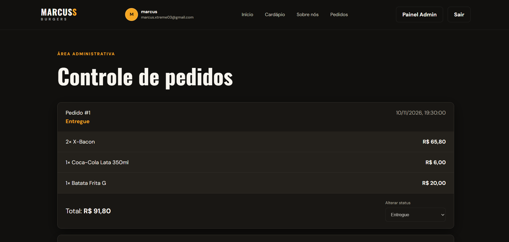

# 🍔 Marcus's Burgers

Aplicação full-stack para uma hamburgueria, desenvolvida com Spring Boot e React, com catálogo por categorias, carrinho persistido, autenticação JWT, gerenciamento de endereços, checkout e acompanhamento de pedidos.

## ✨ Funcionalidades

- Catálogo de produtos agrupado por categoria.
- Imagens individuais dos produtos através de URLs.
- Carrinho com quantidade, remoção, limpeza e persistência no navegador.
- Cadastro e login com autenticação JWT.
- Cadastro e seleção de endereços do usuário.
- Busca automática de endereço por CEP integrada à API ViaCEP no backend.
- Limite de quantidade no carrinho conforme o estoque disponível.
- Controle de estoque com bloqueio pessimista, garantindo que dois pedidos simultâneos não vendam o mesmo último item (coberto por teste de concorrência).
- Atualização automática do catálogo e estoque após finalizar pedidos.
- Perfil do usuário com nome e e-mail no cabeçalho.
- Criação e acompanhamento de pedidos.
- Painel administrativo para acompanhar e alterar status dos pedidos.
- Controle de acesso para usuários `CLIENT` e administradores `ADMIN`.
- Validação de dados com Bean Validation.
- Documentação interativa da API com Swagger UI / OpenAPI.
- Testes automatizados e integração contínua com GitHub Actions CI.
- Layout responsivo para computadores e dispositivos móveis.

## 📸 Screenshots

| Cardápio | Checkout | Painel admin |
|---|---|---|
|  |  |  |


## 🧱 Tecnologias

### Backend

- Java 25
- Spring Boot 4.1.2
- Spring Web MVC
- Spring Data JPA / Hibernate
- Spring Security
- OAuth2 Resource Server / JWT
- Springdoc OpenAPI / Swagger UI
- ViaCEP API com `RestClient`
- Bean Validation
- PostgreSQL
- H2 para o perfil de teste
- Maven
- Lombok
- JUnit 6.0.3

### Frontend

- React 19
- JavaScript ES6+
- Vite 8
- React Router DOM
- ESLint
- npm

### CI

- GitHub Actions
- GitHub Flow

## 📁 Estrutura

```text
ProjetoHamburgueria/
├── .github/
│   └── workflows/
│       └── ci.yml
├── backend/
│   ├── src/main/java/
│   ├── src/main/resources/
│   ├── src/test/java/
│   └── pom.xml
├── frontend/
│   ├── src/
│   │   ├── components/
│   │   ├── hooks/
│   │   ├── pages/
│   │   ├── services/
│   │   ├── styles/
│   │   └── utils/
│   ├── package.json
│   └── vite.config.js
├── docs/
└── README.md
```

## 📋 Pré-requisitos

- Java 25
- Node.js 22 ou superior
- PostgreSQL (opcional, necessário apenas para o perfil `dev`)
- Git

> Os comandos deste README assumem **Windows com PowerShell**. No Linux/macOS, use `./mvnw` no lugar de `.\mvnw.cmd` e `export VAR=valor` no lugar de `$env:VAR="valor"`.

## 🚀 Como executar

Abra dois terminais no VS Code.

### 1. Backend

No diretório do backend:

```powershell
cd backend
```

Execute a aplicação:

```powershell
.\mvnw.cmd spring-boot:run
```

Também é possível executar pelo Maven instalado:

```bash
mvn spring-boot:run
```

O backend iniciará em http://localhost:8080.

> O perfil padrão é `test`, que usa **H2 em memória**. Não é necessário instalar PostgreSQL para experimentar o projeto, e os dados de exemplo do `data.sql` são carregados a cada inicialização.

Para usar o PostgreSQL, configure as variáveis `JWT_SECRET` e `DB_*` (veja [Variáveis de ambiente](#-variáveis-de-ambiente)) e execute com o perfil `dev`:

```powershell
.\mvnw.cmd spring-boot:run "-Dspring-boot.run.profiles=dev"
```

### 2. Frontend

Em outro terminal:

```powershell
cd frontend
npm install
npm run dev
```

O frontend iniciará em http://localhost:5173.

## 🧪 Perfis e banco de dados

O projeto possui configurações para diferentes ambientes:

- `test` (**padrão**): banco H2 em memória, com configurações definidas em `application-test.properties`. Não exige instalação de banco de dados.
- `dev`: PostgreSQL, configurado por variáveis de ambiente.

O perfil ativo é definido em `application.properties` (`spring.profiles.active=test`) e pode ser sobrescrito ao iniciar a aplicação:

```powershell
.\mvnw.cmd spring-boot:run "-Dspring-boot.run.profiles=dev"
```

O perfil `test` também é utilizado pelos testes automatizados, o que evita alterações no banco de desenvolvimento.

## 🔐 Variáveis de ambiente

### JWT

| Variável | Uso |
|---|---|
| `JWT_SECRET` | Assinar e validar os tokens JWT |

A chave JWT deve estar em **Base64** e possuir pelo menos 32 bytes após a decodificação, conforme a configuração HS256 utilizada pelo projeto.

No perfil `test` (padrão), a chave é definida em `application-test.properties`, então a variável só é necessária no perfil `dev` e em produção. O token expira em 3600 segundos (1 hora), valor configurado em `security.jwt.expiration`.

Para gerar uma chave em formato Base64:

```powershell
$bytes = New-Object byte[] 32
[System.Security.Cryptography.RandomNumberGenerator]::Fill($bytes)
[Convert]::ToBase64String($bytes)
```

Exemplo de uso no Windows:

```powershell
$env:JWT_SECRET="sua-chave-base64"
```

### Perfil de desenvolvimento PostgreSQL

| Variável | Valor padrão |
|---|---|
| `DB_HOST` | `localhost` |
| `DB_PORT` | `5432` |
| `DB_NAME` | `hamburgueria` |
| `DB_USERNAME` | obrigatório |
| `DB_PASSWORD` | obrigatório |

Exemplo no Windows:

```powershell
$env:JWT_SECRET="sua-chave-base64"
$env:DB_HOST="localhost"
$env:DB_PORT="5432"
$env:DB_NAME="hamburgueria"
$env:DB_USERNAME="postgres"
$env:DB_PASSWORD="sua-senha"
```

> Não adicione senhas ou chaves reais ao repositório. Utilize uma chave exclusiva para testes e outra para produção.

## 🌐 Configuração da API no frontend

Por padrão, o frontend usa:

```text
http://localhost:8080
```

Para usar outra URL, crie um arquivo `.env` dentro de `frontend`:

```env
VITE_API_URL=http://localhost:8080
```

Depois, reinicie o servidor Vite.

## 📖 Documentação da API — Swagger

O projeto utiliza Springdoc OpenAPI para gerar a documentação da API e disponibilizar uma interface interativa para visualizar e testar os endpoints.

Com o backend em execução, acesse:

| Recurso | URL |
|---|---|
| Swagger UI | http://localhost:8080/swagger-ui/index.html |
| OpenAPI JSON | http://localhost:8080/v3/api-docs |

A documentação permite:

- Visualizar os endpoints disponíveis.
- Consultar métodos HTTP, parâmetros e respostas.
- Visualizar os modelos de requisição e resposta (DTOs).
- Testar requisições diretamente pela interface Swagger.

Os endpoints de documentação são públicos. Os endpoints protegidos continuam exigindo autenticação JWT.

## 📡 Principais endpoints

| Método | Endpoint | Descrição | Autenticação |
|---|---|---|---|
| `POST` | `/auth/login` | Autentica e retorna JWT | Não |
| `GET` | `/products` | Lista produtos | Não |
| `GET` | `/products/{id}` | Busca um produto | Não |
| `GET` | `/categories` | Lista categorias | Não |
| `GET` | `/addresses` | Lista endereços do usuário | Sim |
| `POST` | `/addresses` | Cadastra endereço | Sim |
| `GET` | `/addresses/cep/{zipCode}` | Consulta endereço pelo ViaCEP | Não |
| `GET` | `/orders` | Lista pedidos do usuário ou de todos, para administrador | Sim |
| `POST` | `/orders` | Cria pedido e reduz o estoque | Sim |
| `GET` | `/orders/{id}` | Busca pedido | Sim |
| `PUT` | `/orders/{id}` | Atualiza status conforme as regras de perfil | Sim |

As requisições autenticadas devem enviar:

```http
Authorization: Bearer <token>
```

## 🍔 Dados iniciais

O arquivo `backend/src/main/resources/data.sql` popula o banco com:

- Categorias de hambúrgueres, bebidas e acompanhamentos.
- Produtos com nome, descrição, preço, estoque, categoria e URL da imagem.
- Usuários administrativos e clientes.
- Endereços e pedidos de exemplo.

Credenciais de demonstração (**apenas para desenvolvimento**):

| Perfil | E-mail | Senha |
|---|---|---|
| `ADMIN` | `admin@email.com` | `[senha-de-demo]` |
| `CLIENT` | `marcus@email.com` | `[senha-de-demo]` |

Você também pode criar uma conta nova em `/register`. Contas criadas pela interface têm o perfil `CLIENT`.

> Os usuários do `data.sql` possuem senhas armazenadas como hash BCrypt.
>
> O `data.sql` limpa todas as tabelas (`DELETE FROM`) antes de inserir os dados de exemplo, então os dados são recriados a cada inicialização.

## 🖥️ Páginas do frontend

- `/` — página inicial e cardápio por categoria.
- `/login` — login.
- `/register` — cadastro.
- `/checkout` — endereços e confirmação do pedido.
- `/pedidos` — pedidos do usuário, separados entre ativos e encerrados.
- `/pedidos/{id}` — confirmação e detalhes de um pedido.
- `/admin/pedidos` — painel administrativo de pedidos.

## 📦 Status dos pedidos

```text
PENDING → PREPARING → READY → DELIVERED
   └──────────┴─────────┘
          ↓
      CANCELLED
```

| Status | Descrição |
|---|---|
| `PENDING` | Pendente |
| `PREPARING` | Preparando |
| `READY` | Pronto |
| `DELIVERED` | Entregue (final) |
| `CANCELLED` | Cancelado (final, exibido em vermelho) |

A trilha de acompanhamento do cliente possui 4 etapas (`PENDING` a `DELIVERED`). Pedidos `CANCELLED` são exibidos como pedidos encerrados.

No painel administrativo:

- O status avança uma etapa por vez, sem retroceder.
- `DELIVERED` e `CANCELLED` são estados finais e ficam bloqueados.
- Pedidos ainda ativos podem ser cancelados.

## 🛠️ Comandos úteis

### Frontend

```powershell
npm run dev
npm run build
npm run lint
npm run preview
```

### Backend

```powershell
.\mvnw.cmd test
.\mvnw.cmd clean package
.\mvnw.cmd spring-boot:run
```

## 📦 Build de produção

### Frontend

```powershell
cd frontend
npm run build
```

Os arquivos finais serão gerados em `frontend/dist`.

### Backend

```powershell
cd backend
.\mvnw.cmd clean package
```

O arquivo executável será gerado em `backend/target`.

## 🧪 Testes

O backend possui testes automatizados com **JUnit 6.0.3** e Spring Boot.

Os testes utilizam o perfil `test`, configurado em `application-test.properties`, com banco H2 em memória. Dessa forma, não dependem do PostgreSQL de desenvolvimento.

### Teste de concorrência do estoque

O teste `StockConcurrencyTest` simula dois clientes tentando realizar um pedido simultaneamente para comprar o último produto disponível.

O teste verifica se:

- Apenas um pedido é confirmado.
- O estoque do produto permanece em zero.
- Apenas um pedido é registrado no banco de dados.

A implementação utiliza `CountDownLatch` para sincronizar o início das requisições concorrentes e valida o controle de estoque com bloqueio pessimista no banco de dados.

### Executar os testes

Na pasta `backend`, execute todos os testes:

```powershell
.\mvnw.cmd test
```

Para executar apenas o teste de concorrência:

```powershell
.\mvnw.cmd -Dtest=StockConcurrencyTest test
```

Para executar os testes e validar o build:

```powershell
.\mvnw.cmd clean verify
```

## ⚙️ Integração contínua — GitHub Actions

O projeto utiliza **GitHub Actions** para executar automaticamente verificações de integração contínua (CI).

O workflow está localizado em:

```text
.github/workflows/ci.yml
```

### Quando o CI é executado?

O workflow é acionado:

- A cada `push` para a branch `main`.
- A cada Pull Request direcionado à branch `main`.

### Backend

O job do backend:

- Configura Java 25.
- Ativa o perfil `test`.
- Utiliza H2 em memória.
- Executa os testes automatizados.
- Valida o build com Maven.

Comando executado:

```bash
bash ./mvnw -B clean verify
```

A chave JWT utilizada nos testes é exclusiva do perfil `test`, definida em `application-test.properties`. O CI não precisa acessar a chave JWT de desenvolvimento ou produção.

### Frontend

O job do frontend:

- Configura Node.js 22.
- Instala as dependências com `npm ci`.
- Executa o ESLint.
- Gera o build de produção.

Comandos executados:

```bash
npm ci
npm run lint
npm run build
```

### GitHub Flow

O desenvolvimento segue o fluxo:

1. Criar uma branch para a funcionalidade ou correção.
2. Implementar e testar as alterações.
3. Enviar a branch para o GitHub.
4. Abrir um Pull Request para `main`.
5. Aguardar a aprovação dos checks do CI.
6. Fazer o merge para `main`.

O CI valida o backend e o frontend antes da integração das alterações na branch principal.

> O workflow atual realiza integração contínua (CI). O deploy automático (CD) poderá ser configurado posteriormente com a plataforma de hospedagem.

## 👨‍💻 Autor

**[Seu nome]**

Projeto pessoal de portfólio para praticar desenvolvimento full-stack com Java, Spring Boot, React e integração de APIs REST.

- LinkedIn: https://www.linkedin.com/in/marcusantosdev
- GitHub: https://github.com/MarcuSantosDev
- E-mail: marcus.xtreme03@gmail.com

## 📄 Licença

Distribuído sob a licença MIT. Consulte o arquivo `LICENSE` para mais detalhes.
